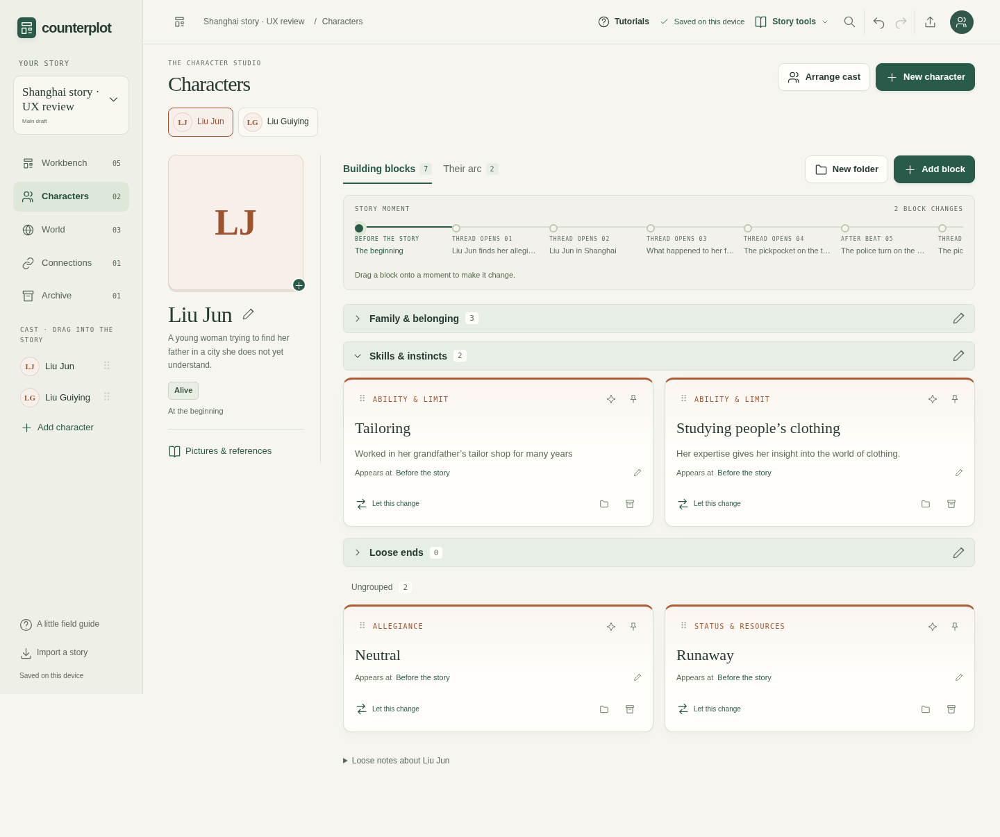
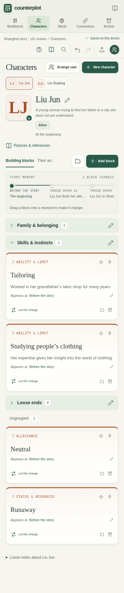
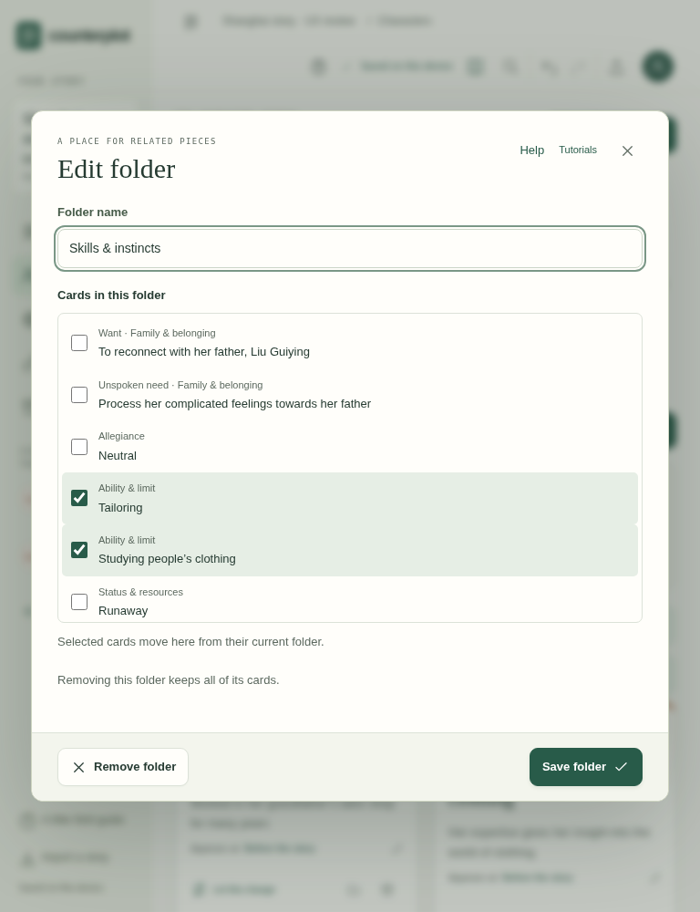

# Character card folders · 15 October 2026

Characters → Building blocks now supports compact, custom-labelled, collapsible folders. Use **New folder** beside Add block, name the folder, and select its cards. Each card also has a folder control for moving it to an existing folder, a new folder, or Ungrouped. Desktop dragging works on folder headers (including collapsed folders), other cards, and the Ungrouped drop area.

The header is 42px tall on desktop/tablet and 44px at phone widths. It contains a chevron, ellipsised label, card count, and edit button. Expanded folders retain the existing card grid. On phones, New folder becomes an accessible folder icon so the toolbar stays on one row at 390px. The folder editor keeps Remove and Save together in a compact footer. An empty Ungrouped section appears only while dragging. Folders have one level and belong to the individual character.

## Behavior and data integrity

- Labels, membership, and collapsed state persist in the story and its portable copies.
- Grouping follows a card across story moments. It does not modify its text, timing, or character history.
- Edit folder supports bulk selection; collections over eight cards have a search field. Filtering keeps checked selections. Choosing a card already in another folder moves it.
- Removing a folder keeps its cards. Folder edits, moves, and removal support Undo.
- Archived cards keep their folder membership for restoration. Permanent deletion removes obsolete membership. A duplicate character receives independent folder and card IDs; duplicate cards inherit their folder.
- Retiming a card preserves membership. Removing its only recorded appearance removes the obsolete reference.
- Keyboard focus returns to the folder header after editing, or to the moved card. Moving to a collapsed folder focuses its header. A fresh click after dragging is no longer swallowed by the release-click guard.
- Native labels, expanded states, controlled regions, and touch-friendly move controls support keyboard and touch use. Printed output includes the cards in collapsed folders.

## Verification

- Model regressions cover grouping, moving, renaming, reload/validation, archive/restore/purge, duplicate/rekey, timing changes, invalid data, and merging independent folder/character edits.
- Eight browser scenarios cover the primary workflows, keyboard behavior, persistence, unchanged history, bulk search, drag movement, and narrow-width geometry. Chromium runs desktop, phone, and tablet projects; Firefox and WebKit run desktop workflows. Desktop-only drag scenarios are deliberately skipped in touch projects, which exercise the Move card control.
- `npm test`, `npm run test:workshop`, and `npm run check` pass locally.
- The separate visual audit tests normal and dense cards at 320, 390, 768, 1024, 1440, and 1920px, across the card view and both folder dialogs: **36 layout checks** with no horizontal overflow, clipped controls, or page errors. Nine axe scans report no WCAG A/AA violations. Automated checks supplement visual inspection; they are not a claim of exhaustive accessibility certification.
- The wider browser run also caught plot-tab scrolling resetting during a quick outline edit. The renderer now captures the live scroll position before replacing the toolbar and ignores events from detached toolbars. A deterministic browser regression covers the race.
- Full repository browser checks run on the pull request before merge.

[Layout measurements](layout-results.json) · [Reproducible audit](audit.cjs) · [Browser regressions](../../../workshop/browser-tests/block-folders.spec.js) · [Model regressions](../../../workshop/tests/block-folders.test.cjs)

## Screenshots

Desktop:

Phone:

Tablet folder editor:

Additional captures show [tablet cards](cards-768.png), the [phone folder editor](edit-folder-390.png), and the [phone move control](move-card-390.png).
