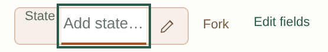
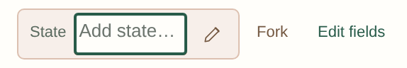

# Inline control visual polish

The reported raised “State” label came from the preceding multiline-field change: `.arc-state` and its pencil button were explicitly top-aligned. The label sat about 7 pixels above the pill's center on desktop and about 12 pixels above it in the empty tablet example. An outward focus outline also crossed the pill border. The previous overflow checks did not detect those alignment problems.

Before:

After:

These captures reproduce the reported layout with a synthetic story; they do not contain account or manuscript data.

## Changes

- Center state labels and pencil actions in Outline, Refine, and the title/state editor, including empty and multiline values.
- Keep focus indicators inside editable pills and compact pencil buttons. Preserve visible keyboard focus, with rounded field corners and consistent opening/closing text weights.
- Reserve space for short labels, wrap long custom labels, and keep empty state hints on one line.
- Align the related World, Entering, Question, Known, Before, Disruption, Resolution, Answer, Leaving, and custom planning fields. Use 16-pixel input text on phones.
- Keep a closing state's Fork action attached to its outcome. Keep each beat's arrow, result, pencil, and Fork action together when the row wraps; short results no longer reserve a full-width line.
- Size recorded-state fields to their content and allow long subject names to wrap.
- Use compact, named Tutorial and Story tools controls at narrow tablet widths so the account menu stays with the toolbar. Save status remains visible.
- Correct Scene constructor's singular count to “1 included story moment.”

## Verification

`inline-controls.spec.js` checks alignment, non-overlap, readable multiline values, contained focus indicators, long custom labels, grouped actions, and tablet toolbar layout. It runs in Chromium's desktop, phone, and tablet projects and in Firefox and WebKit. Existing field-sizing, character-arc, story-field, and responsive-spacing checks also passed locally.

The final visual sweep covered **216 combinations**: nine main views, four story shapes (ordinary, empty, long, dense), and six sizes (320×568, 390×844, 640×360, 768×1024, 1024×768, and 1440×1000). It found no page overflow or browser errors. **27 Axe scans** reported no violations. Focused before/after screenshots and screenshots of the main views were reviewed as well.

The pull request runs the complete existing Chromium, Firefox, and WebKit suites before merge. Testing uses synthetic stories and browser/device emulation; physical devices and manual screen-reader testing are not claimed.
