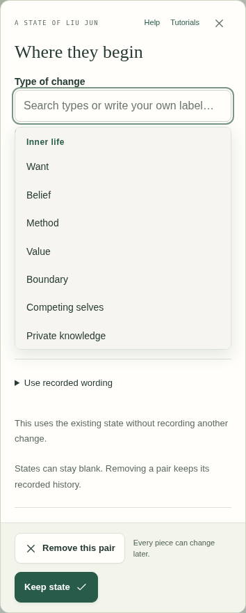
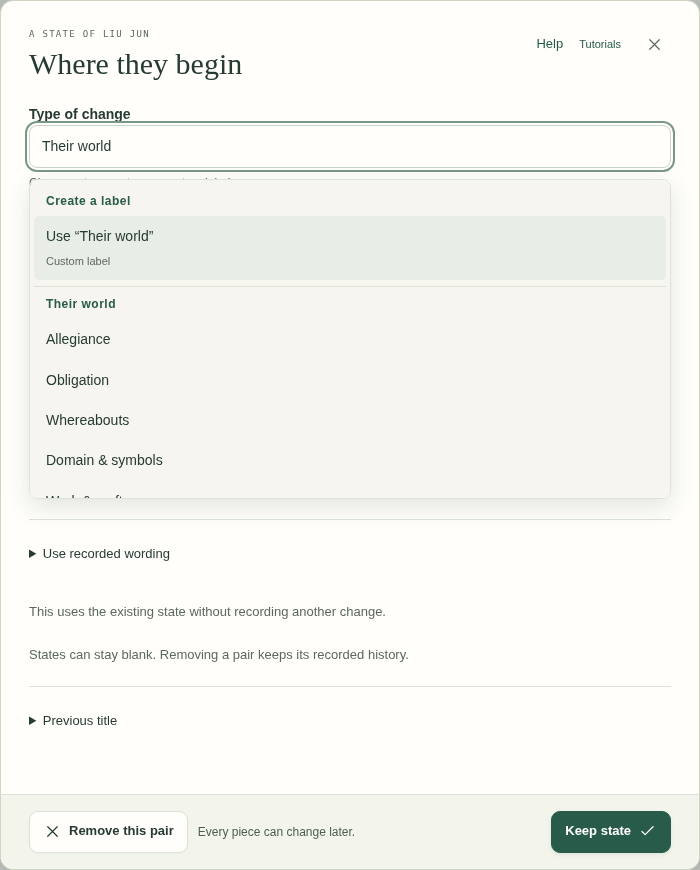

# Compact fields, change categories, and unchanged states

This follow-up addresses the extra space inside editable pills, navigation in **Type of change**, and duplicate character changes when reusing an existing state.

## Field width

The previous width calculation multiplied the number of characters by `ch` (the width of a zero). That overestimated narrow text and underestimated wide letters and Chinese characters. Some phone styles also expanded short fields across the available row.

All compact planning, custom, character, recorded-state, and beat-state textareas now use their rendered text width, including the active font and padding. Short values grow and shrink during typing; longer values wrap within the available width. The same calculation runs on initial render, resize, modal opening, and font loading.

At a 1600px viewport, `She's on a train from Jiax` previously left 40.7px of unused space after the text; it now leaves 2.7px for the caret. Twelve narrow `i` characters dropped from 51.3px of excess space to 2.3px. Wide letters and Chinese no longer wrap prematurely. Measurements are in `width-before.json` and `width-after.json`.

## Type of change

The dropdown uses the character library's existing categories: Inner life, Presence, History, Everyday life, Their world, and Your own. Saved custom labels appear under Your labels. Headers remain visible as their section scrolls, and searching matches category names as well as individual types. Screen readers receive labelled groups; arrow keys select only options. Custom labels, Escape, Enter, and saved classifications retain their existing behavior.

## Reusing states

Saving a state that matches the building block already in effect keeps its reference without inserting a new history record. Editing a change back to its preceding state removes that now-redundant record. Actual changes, new blocks, forks, and returns to an older state after an intervening change remain recorded.

Their arc and its counts omit previously stored identical snapshots. This display filter does not delete old saved history. It compares full block state, rather than text alone, and accounts for multiple records at the same moment and saved character states. Raw history remains available to timing, archive, and editing operations. The editor explains when it is reusing an unchanged state.

## Verification

- Focused browser checks cover Chromium desktop, touch phone, and tablet; Firefox; and WebKit. They exercise proportional and multilingual text, typing/deletion, long wrapping, custom fields, state outcomes, category search, every keyboard option, accessibility, undo/redo, and reload persistence.
- Model regressions cover unchanged openings, real later reversals, faction references, new/forked additions, existing duplicate history, detail changes, multiple changes at one moment, and empty saved-state checkpoints.
- The layout sweep covered 216 combinations: nine views, four story shapes (normal, empty, long/nested, dense), and six viewports from 320px to 1440px, including phone landscape. No page overflow, JavaScript errors, or clipped entered values were found. Long empty hints retain their existing ellipsis behavior in narrow columns.
- All 27 broad accessibility scans passed. The open category picker also passed its focused accessibility checks in the three browser engines. WebKit's initial scan sampled the opening animation; the test now requests reduced motion before measuring contrast.
- Build consistency, syntax checks, and both unit-test suites passed locally. Repository CI runs the complete Chromium, Firefox, and WebKit suites before merge.

These are browser emulations and synthetic story fixtures, not physical-device testing or edits to a user's saved story.
